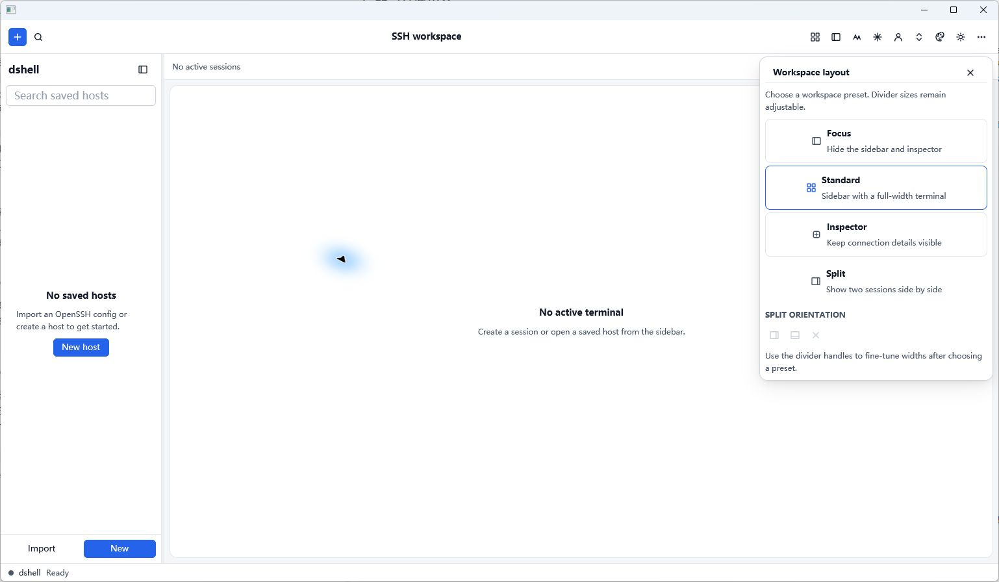
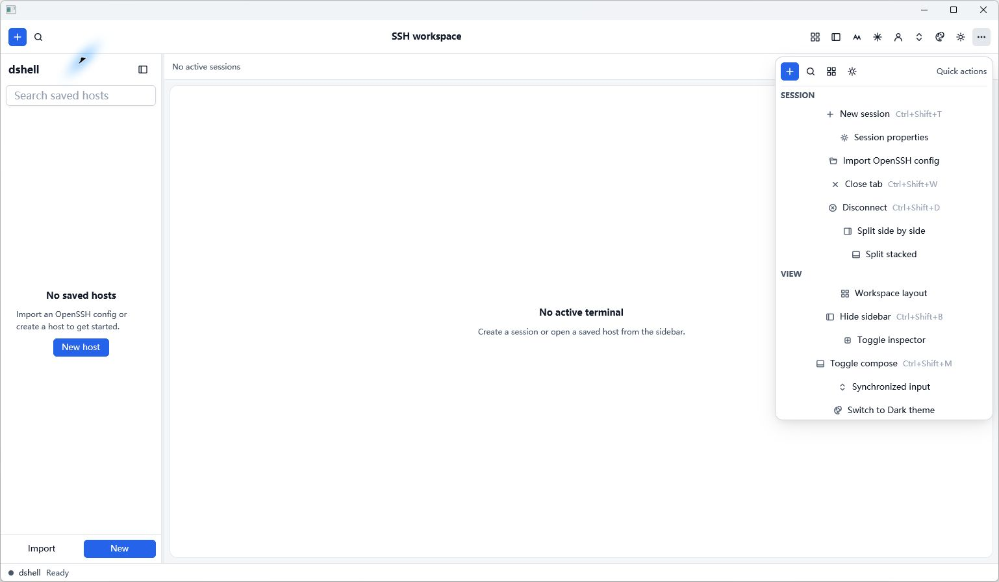
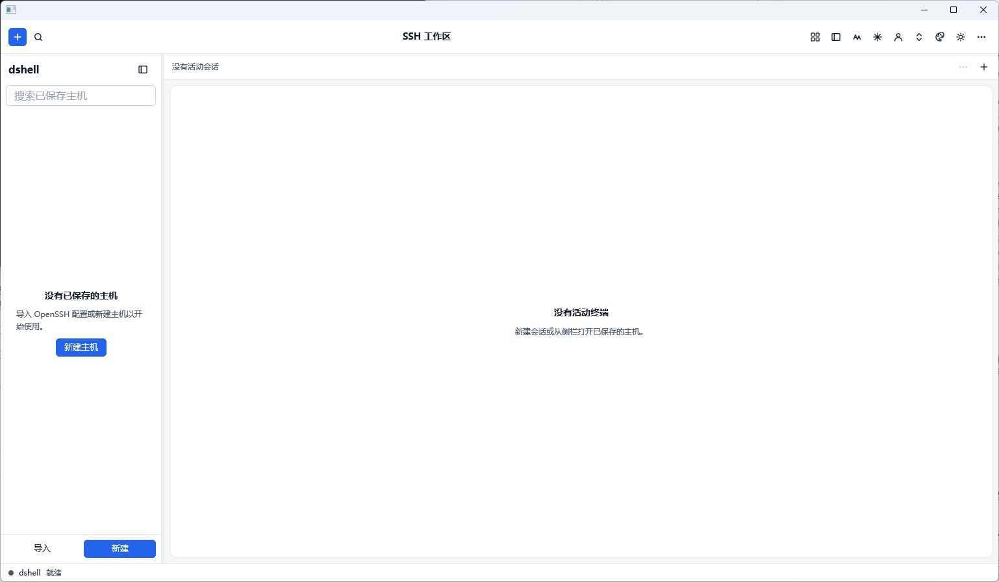
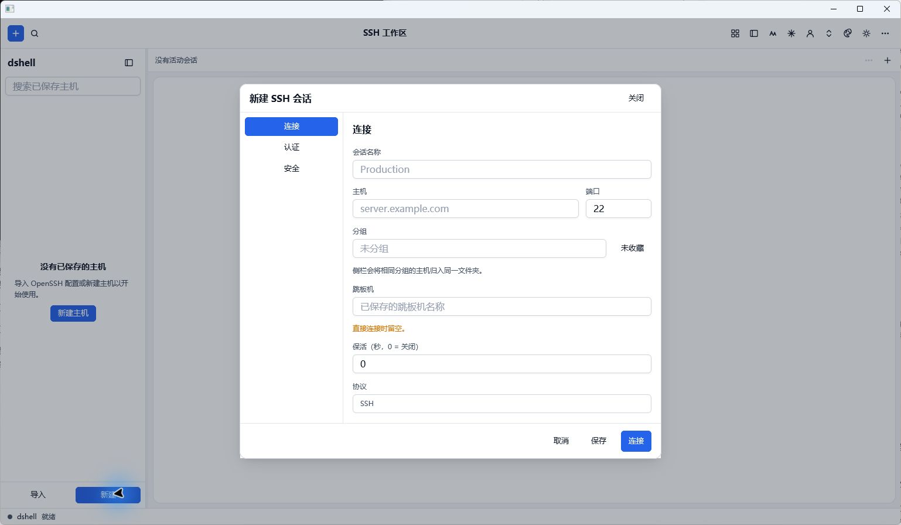
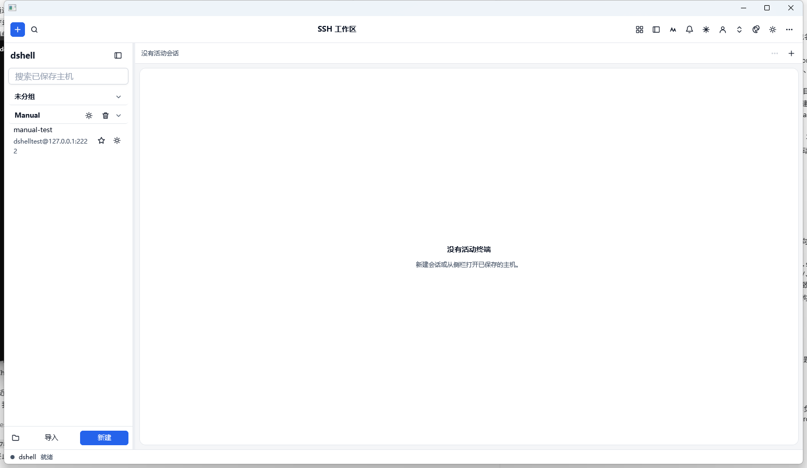
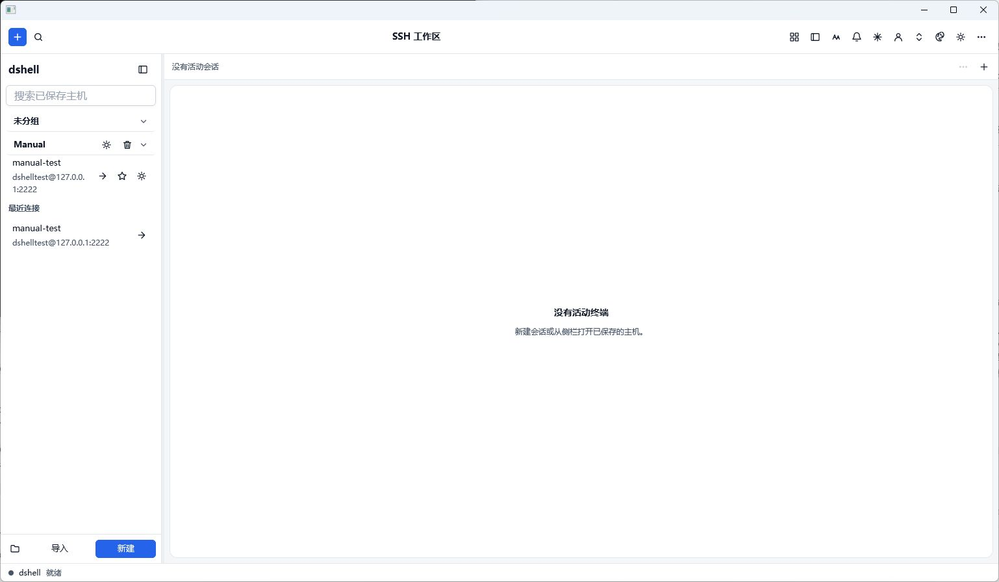

# dshell

dshell is a Rust-native SSH desktop client built with GPUI, russh, and
alacritty_terminal. The terminal UI is drawn by GPUI; there is no WebView
runtime. The first public release is `v0.1.0`; the current release is `v0.1.24`.
See [CHANGELOG.md](CHANGELOG.md) for release scope and verification.

The application shell supports English and Simplified Chinese. Open `Settings`,
choose a language, and press `Apply`; the choice is saved in
`%APPDATA%\dshell\settings.json` on Windows. Terminal content and remote
command output remain unchanged.

Host groups in the sidebar can be created, renamed, deleted, collapsed with
their chevron header, and reordered by dragging one group header onto another.
Deleting a group moves its hosts to `UNGROUPED`. Group definitions, collapsed
state and order are saved with the UI settings; older settings files load with
all groups expanded and the groups in their default order. The Simplified
Chinese shell also covers profile load/save/delete feedback and the main menu
footer. The Session menu can export saved host profiles to a versioned JSON
backup and import that backup later; exported files contain no recent history,
passwords, passphrases or private key material, and imports skip duplicate
profile names without overwriting existing entries.

The Keys panel can discover existing OpenSSH identities, import a private key
into `~/.ssh`, export a key pair to a user-selected path, change a passphrase,
copy a public key, and delete a key pair after an explicit confirmation. Key
files are parsed before transfer, existing destinations are never overwritten,
and passwords or passphrases are stored with saved host profiles for direct
reconnection. Exported profile backups still omit all credentials.

Drag with the left mouse button to select terminal text. Use `Ctrl+Shift+C` to
copy a non-empty selection and `Ctrl+Shift+V` to paste from the system clipboard;
the terminal's bracketed-paste mode is respected.

## Run

The server host key must already be present in the current user's OpenSSH
known_hosts file. Unknown or changed keys are rejected. Verify a key out of
band before adding it to known_hosts.

Run `cargo run --locked`, enter the host, port, user, and credentials in the
connection bar, then connect. Authentication supports a password, an OpenSSH
private key file (with an optional passphrase), keyboard-interactive
authentication, or the system SSH agent (Windows OpenSSH named pipe or Pageant;
`SSH_AUTH_SOCK` on Unix). A plain password prompt in keyboard-interactive mode
uses the password field; one-time-password or other extra prompts open a masked
dialog that sends responses only to the SSH server. Clicking a saved host row or
its connect icon opens a credential-only dialog when no in-memory credential is
available in the saved profile or current run; the edit icon opens the session properties. After a successful
connection, the password or passphrase is saved to the host profile and reused
on the next connection. A rejected credential clears that cache and reopens the
dialog, while Cancel abandons and removes the failed connection. Each connection opens an independent session tab; switching tabs
preserves each session's terminal state, and closing a tab ends only that SSH
session. The password and key passphrase fields are masked and cleared when
connection starts. Click the terminal area to focus it, then use the
keyboard as you would in a remote terminal. The terminal grid follows window
resizing. When the remote application enables mouse tracking, clicks, motion,
and the wheel are sent to it; otherwise, left-button dragging selects text and
the wheel browses terminal history.

For a repeatable local manual test, run
`powershell -NoProfile -ExecutionPolicy Bypass -File scripts\\start-docker-ssh-manual.ps1`.
It starts a temporary Ubuntu OpenSSH service bound only to `127.0.0.1:2222`
and prints a generated username, password, SHA256 host-key fingerprint and the
`known_hosts` line for review. Add that line manually only after checking the
fingerprint; stop the service with `docker rm --force dshell-ssh-manual`.

The inspector includes `Server health`, `Processes` and `Services` groups for
connected sessions. Press `Refresh` to run short read-only commands through
separate SSH exec channels and display the remote OS, kernel, load average,
memory, root filesystem usage, uptime, a bounded process list, and service
states. Each process row has a confirmed `Terminate` action that sends `SIGTERM`
to the remote PID and refreshes the list. Each service row can read the latest
bounded log lines through `journalctl`, with a `service status` fallback when
systemd is unavailable. Probe and log output stays in the current session
memory and is not added to the terminal stream, session log or host profile.
Each request has a three-second timeout and a 64 KiB response limit. Server
alert thresholds for process CPU, memory use and root-disk use are configurable
in Settings and persist in the versioned settings file.

The Server health group also provides confirmed `Reboot server` and `Shut down
server` actions. They use fixed commands through separate SSH exec channels,
show the result in the inspector, and may disconnect the current session.

Use `Cancel` while the SSH handshake is in progress and `Disconnect` to end an
active session. Remote exit and connection failure clear the terminal view so a
new connection starts with a clean session.

Saved hosts can be searched, loaded into the connection bar, updated, and
deleted from the left panel. Hosts may be assigned to a group, marked as a
favorite, and filtered by any of those fields. Drag a saved host row onto a group
header (or `UNGROUPED`) to move it; the new group is saved immediately. Drag a
group header onto another group header to change the saved group order. The
sidebar lists favorites, groups, and the most recent connections; selecting a
recent entry loads the matching saved host when one exists, otherwise it fills
the connection form.
The `Import` button reads an OpenSSH `config` file
and creates host profiles for supported entries (Host, HostName, User, Port,
IdentityFile, LocalForward, RemoteForward, DynamicForward,
ServerAliveInterval and Include). Hosts containing options that cannot be
mapped safely — such as ProxyJump, ProxyCommand, StrictHostKeyChecking,
Match blocks, agent/X11 forwarding or connection multiplexing — are skipped or
reported rather than silently imported. Imported hosts are placed in the
`Imported` group.
The profile file stores the display name, host, port, username, group, favorite
flag, authentication method, optional identity file path, optional jump host
name and saved credentials, plus the recent connection history. On Windows it
is stored at `%APPDATA%\dshell\hosts.json`; the private key itself is never
copied, and exported profile backups omit all credentials.

To connect through another saved host, enter its name in the `Jump host` field
of the session properties. The jump host and the target authenticate
separately, and both server keys must already be present in known_hosts.
Jump-host passwords and key passphrases are requested in their own fields,
saved with the target host profile after a successful connection and cleared
from the form when the connection starts. The Services inspector also exposes
confirmed Start, Stop and Restart actions for supported remote service managers.

The Authentication section can save reusable templates in
`%APPDATA%\dshell\auth_profiles.json`. A template stores the authentication
method, optional identity-file path, optional jump-host reference and keep-alive
interval. Passwords, passphrases and key material are never stored. Applying a
template fills those fields and clears any secret inputs; it does not start a
connection. Templates are edited explicitly with Save template and Delete.

Use the `Files` button in the session toolbar to open the SFTP panel. It lists
the remote working directory, supports entering directories and going up, and
can upload or download single files and entire nested directories with the
native file picker. Existing remote or local targets offer Overwrite, Resume or
Keep existing; Resume continues from the current target size when it is smaller
than the source and restarts from zero when it is larger. Transfers show
progress and can be cancelled. Multiple selected uploads and repeated file or
directory actions are serialized in a per-session FIFO queue; the panel shows
the queued count and can clear waiting transfers. Cancellation uses a best-effort cleanup of
entries created by that transfer while preserving partially resumed files. The
panel can also create directories, rename entries, and delete files or empty
directories; deletion requires a second confirmation. Symbolic links are
skipped. Each entry shows its permission mode and modification timestamp; the
metadata action edits octal permissions plus Unix access and modification
seconds through SFTP `SETSTAT`. The panel also shows remote filesystem usage,
available/free space, block size and maximum filename length when the server
supports the OpenSSH `statvfs` extension.

Use the `Tunnels` button to manage port forwarding for the active session.
Local forwards listen on this machine and connect through the SSH server;
remote forwards listen on the server and connect back to a target reachable from
this machine; Dynamic exposes a SOCKS5 proxy whose clients choose the target.
Listen port `0` asks the operating system or SSH server to choose a port. Each
rule shows its active connection count and can be stopped independently.
Forwarding rules added for a saved host are stored in that host profile and
started automatically the next time it connects.

The session properties also accept a keep-alive interval in seconds (`0`
disables it). A positive value makes the client send keepalive messages when
the connection is idle.

Use the `Log` button to record terminal output to a file. Logging is off by
default and starts only after you choose a destination in the native save
dialog. New log files use a timestamped record format: each 16 ms output batch is
written with its Unix timestamp, and the replay view builds a timeline from
those records. Appending to an existing legacy raw log keeps the raw format and
has no timeline. The file contains the remote byte stream, including ANSI escape
sequences and anything printed in the terminal, so it may contain sensitive
data. Stop logging with the same button or by disconnecting.

Use the `Replay log` button to open a previously recorded log in a read-only
terminal overlay. The log is parsed by the same terminal emulator, so colors and
cursor addressing are reproduced. Timestamped logs show `Prev event`,
`Next event` and the relative time of the selected record; each jump rebuilds the
view from the beginning through that record. Files larger than 16 MiB replay
their tail, starting at a complete record boundary for timestamped logs; use
Top, Bottom or the wheel to browse the available scrollback.

Use the `Quick commands` button to manage reusable commands. Commands are
stored in `%APPDATA%\dshell\snippets.json` on Windows and shown as a flat
button grid with icon actions for run, edit and delete. A command can be sent
to the active session or broadcast to explicitly selected connected sessions.
The `Send + Enter` / `Paste only` toggle controls whether the command is
submitted immediately.

Use the `Keys` button to manage local OpenSSH identities. The 560 px modal
discovers likely private keys in `~/.ssh` without reading private-key contents,
shows their public-key algorithm and path, and can fill a host's identity-file
field or copy a matching `.pub` key. It also generates new key pairs and
supports Ed25519, RSA 3072/4096 and ECDSA P-256/P-384. Choose the private key
path, an optional passphrase and a comment; the private key and a matching `.pub`
file are created without overwriting existing files. The passphrase is not
stored, and Unix key files are created with mode `0600`. Each discovered key
also has a Change passphrase action. The old passphrase is checked before any
write, an empty new passphrase removes encryption, and the public-key comment
is preserved. Updates are staged beside the original key and replaced
atomically.

Use the `Settings` button to change the terminal font family, size (9-32 px),
color theme (Default dark, Solarized dark or Solarized light), cursor style
(Block, Underline or Bar) and workspace shortcuts. Settings open in a centered
760×600 modal. Settings are stored in
`%APPDATA%\dshell\settings.json`; applying a new font recalculates cell metrics,
terminal columns/rows and active PTY sizes, and the selected palette and cursor
style are pushed to every active session. Shortcut values use the form
`ctrl+shift+t`, `alt+F12` or `cmd+space`; invalid or duplicate bindings are
rejected without saving.

Session properties, settings, key generation, keyboard-interactive
authentication and log replay open as modal overlays sharing the same scrim,
radius, border and shadow. `Escape` closes any of them; when a deletion is
awaiting confirmation, the first `Escape` cancels only the confirmation. In
destructive confirmations the safe action (Keep, Cancel or Keep existing) comes
before the danger action in the focus order. Successful profile saves, deletions,
imports, settings changes, key generation and terminal copy/paste appear as
auto-dismissing toasts in the lower-right corner; a toast can also be closed
manually.

While a terminal has focus, the default workspace shortcuts are `Ctrl+Shift+T`
for a new session, `Ctrl+Shift+W` close tab, `Ctrl+Shift+F` files,
`Ctrl+Shift+S` quick commands, `Ctrl+Shift+O` settings, `Ctrl+Shift+B` toggle the
saved-host sidebar, `Ctrl+Shift+M` toggle the compose pane, `Ctrl+Shift+D`
disconnect, `Ctrl+Shift+R` replay log and `Ctrl+F` find. `Alt+1` through `Alt+9`
always select a session tab. `Ctrl+Shift+C` and `Ctrl+Shift+V` remain copy and
paste.

The command bar switches between the dark and light UI palettes and remembers
the choice, together with the collapsed/expanded sidebar state, in
`%APPDATA%\dshell\settings.json`. Terminal colors stay controlled by the
separate terminal theme setting.

Both UI palettes use the same semantic tokens for every panel, including the
SFTP, forwarding and snippet panels, and automated tests check WCAG AA body-text
contrast on every surface plus status-pill text contrast. Terminal selection
foreground and background come from the active terminal theme. Window geometry
is expressed in logical pixels, so the 100%/150%/200% DPI scaling and 9-32 px
font sizes all drive the same column/row calculation; tests cover the full font
range and the logical viewports produced by common DPI scales. Text entry uses
the native `InputState` control so Windows IME composition is handled by the
platform rather than a custom text editor.

The find bar searches the active terminal and its scrollback, or the open log
replay, using case-insensitive single-line matching. Enter moves forward,
Shift+Enter moves backward, and Prev/Next wrap around; Escape closes the bar.
Matches are selected in the terminal, so `Ctrl+Shift+C` copies the current
match. New terminal output or a resize clears the match list and the next search
starts from the first match.

Each terminal card has a floating toolbar in its top-right corner with Find,
Copy, Paste, Replay log, Send file and the inspector toggle. The toolbar is
dimmed until the pointer enters the card. The find bar spans the card width minus
32 px. The inspector on the right (default 380 px) has four independently
collapsible groups: Transfers shows the active transfer's name, direction,
progress and live rate with a cancel action; Forwards lists active rules with
their listen address, target, bound port and active connection count, and keeps
stopped rules so they can be restarted; Connection shows the host, session state,
terminal size, authentication method, verified host-key algorithm and SHA256
fingerprint, profile, jump host, keep-alive and logging state; Log shows whether
the session is recording, the current file, and actions to start/stop logging or
open a replay. Opening or closing the
inspector recalculates the terminal columns and resizes every active PTY;
collapsing a group does not change the terminal size.

Drag the divider between the sidebar and the workspace, or between the
workspace and the inspector, to resize them. The sidebar accepts 200-360 px and
the inspector 300-520 px; both widths are stored in `settings.json`, and the PTY
is resized once when the drag ends. Dragging a session tab onto another tab
reorders the tabs; `Alt+1` through `Alt+9` follow the visual order without
reconnecting the sessions.

Press `Ctrl+Shift+M` or use the compose button in the terminal toolbar to open
the 96 px compose pane below the terminal. It accepts multi-line input and sends
the whole draft to the active session with `Ctrl+Enter`; `Escape` closes it. The
last 20 drafts are kept for the History button, and opening the pane does not
clear the terminal selection.

Use the `Sync` button in the command bar to choose connected sessions for
synchronized input. While enabled, keyboard input, terminal paste and compose
sends are mirrored to every selected session; mouse input, scrolling and PTY
resize stay per-session. The status bar shows `Sync N`, and closing a session
removes it from the target set. Snippet broadcast remains a separate, explicit
action.

The command bar uses flat icon actions with tooltips instead of text buttons.
The ellipsis opens a grouped menu with icon, label and shortcut hints, plus a
compact row of new-session, host-search, layout and settings actions:
`Session` (new session, properties, import config, close tab, disconnect,
splits), `View` (sidebar, inspector, compose, synchronized input, theme) and
`Tools` (files, tunnels, logging, replay, find, quick commands, keys, settings). The
menu closes with `Escape` or a click outside it.

The layout icon opens a flat workspace preset menu with `Focus` (terminal only),
`Standard` (sidebar plus terminal), `Inspector` (connection details beside the
terminal) and `Split` (two sessions side by side). The split preset is disabled
until two sessions are open; the same menu also offers side-by-side or stacked
orientation and a close-split action. Divider handles remain available for fine
tuning. The session-tab ellipsis button or a tab right-click opens icon actions
for properties, split, disconnect, close, close other tabs and close tabs to the
right.

The layout preset and More menus use application-provided SVG icon assets, so
their icons render in a fresh `cargo run` build. Windows UI evidence:





The Simplified Chinese shell is persisted in `settings.json` and now covers the
session editor, SFTP, tunnels, quick commands, synchronized input, keyboard-
interactive authentication, inspector and validation feedback. A fresh
Windows build was captured while the Chinese language was active:







The `v0.1.17` build keeps the Chinese workspace and records the saved-host
credential flow:



Use the `Keyword highlights` button to keep up to 32 literal keywords in memory.
Highlighting is disabled by default, case-insensitive, and applies to live
terminals and log replay. The `Triggers` Bell button adds bounded rules that are
also disabled by default. Each rule can highlight matching output, show a Toast,
or send preset text through the existing terminal queue, optionally followed by
Enter. Trigger rules never execute arbitrary scripts and are kept in memory only.

dshell targets the daily Xshell-style workflow as an open-source, native
application: session management with groups and recents, tabbed and split
terminals, an inspector for transfers/tunnels/connection/logging, SFTP with
resume, local/remote/SOCKS5 forwarding, timestamped logs with a replay timeline,
and Ed25519/RSA/ECDSA key generation. Telnet, Rlogin, Serial and RDP are outside
the current scope. See [ROADMAP.md](ROADMAP.md) for the capability matrix and
remaining work.

## Test and Verify

Run the unit tests directly:

```powershell
cargo test --locked
```

Run the full repository checks from PowerShell:

```powershell
.\scripts\verify-hard-constraints.ps1
```

The verification script checks formatting, all-target compilation, unit tests,
and the resolved dependency graph for WebView/Electron packages.

Run the SSH/PTY integration test against a temporary Ubuntu 24.04 OpenSSH
container (Docker required):

```powershell
.\scripts\test-docker-ssh.ps1
```

The script builds a local `dshell-ssh-test:ubuntu-24.04` image with OpenSSH,
Vim, tmux, and htop. Docker reuses the package-install layer on later runs, so
`apt-get update` runs again only when that build layer is invalidated. Each test
uses a random temporary password and isolated `known_hosts` file, then removes
the container and temporary host-key file. The SSH/PTY round trip exercises
Vim's full-screen buffer and Unicode input/save/readback.

For a service that stays available while you manually exercise the desktop UI,
run:

```powershell
.\scripts\start-docker-ssh-manual.ps1
```

The script binds OpenSSH only to `127.0.0.1:2222`, prints a temporary
`dshelltest` password, and prints the server fingerprint plus the exact
`known_hosts` line. Verify the fingerprint out of band, then add that line to
your OpenSSH `known_hosts` manually before connecting from dshell. The script
never edits `known_hosts` and never writes the password to disk. Stop the
container after testing with:

```powershell
docker rm --force dshell-ssh-manual
```

See [IMPLEMENTATION_STATUS.md](IMPLEMENTATION_STATUS.md) for the current
implementation boundary and next-session handoff. [ROADMAP.md](ROADMAP.md)
documents the product direction, SSH workflow priorities, and
staged implementation and acceptance plan.

## License

Licensed under the MIT License. See [LICENSE](LICENSE) for details.
